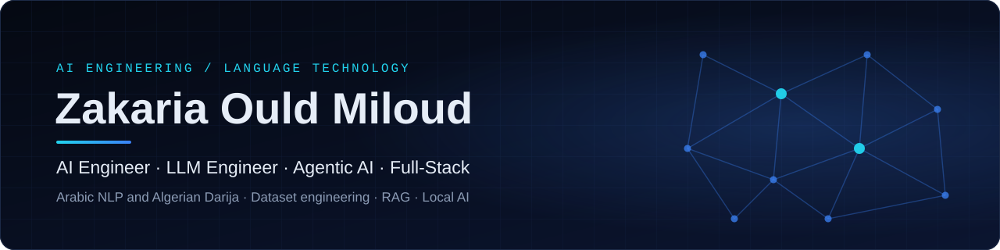
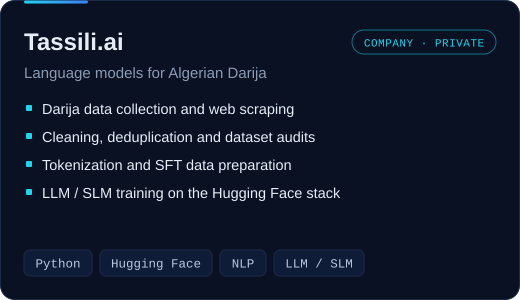
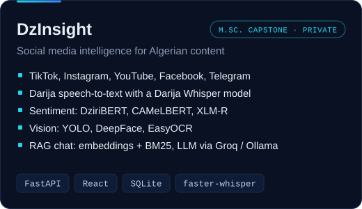
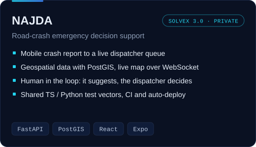
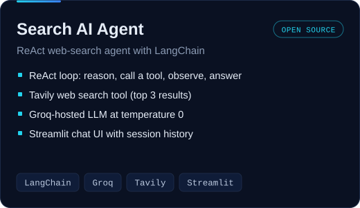
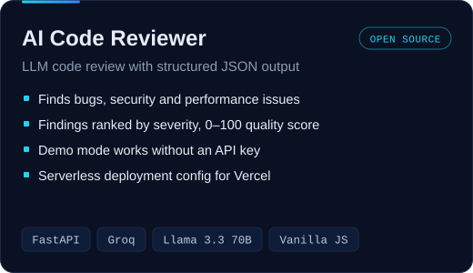
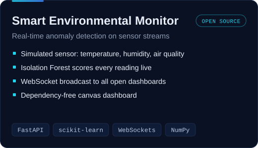

  

  
  
  
  

## About

I am an AI engineer working on language models and the systems built around them. I hold a **Master's degree in Computer Science, specialized in Artificial Intelligence**, from Université Abdelhamid Ibn Badis de Mostaganem, Algeria.

At [**Tassili.ai**](https://www.tassili.ai), I work on language models for **Algerian Darija**: collecting and cleaning dialect data, building datasets, and preparing it for training and fine-tuning. Outside of model work, I build full-stack AI applications: FastAPI back ends, React front ends, retrieval pipelines and LLM agents. Most of them run locally or self-hosted.

## Focus areas

<table>
  <tr>
    <td width="33%" valign="top">
      <b>LLM engineering</b> 
      Fine-tuning, evaluation, SLMs, structured outputs, local inference
    </td>
    <td width="33%" valign="top">
      <b>Arabic NLP and Darija</b> 
      Dialect data, tokenization, sentiment, speech-to-text
    </td>
    <td width="33%" valign="top">
      <b>Dataset engineering</b> 
      Scraping, cleaning, deduplication, auditing, SFT data
    </td>
  </tr>
  <tr>
    <td width="33%" valign="top">
      <b>RAG</b> 
      Embedding and BM25 retrieval, grounded answers over documents
    </td>
    <td width="33%" valign="top">
      <b>Agentic AI</b> 
      Tool-using agents, LangChain, multi-agent systems, MCP
    </td>
    <td width="33%" valign="top">
      <b>Full-stack AI apps</b> 
      FastAPI, React, WebSockets, SQL, CI/CD
    </td>
  </tr>
</table>

## Tech stack

  

  
  
  
  
  
  
  
  
  
  

## Featured work

<table>
  <tr>
    <td width="50%" valign="top">
      
    </td>
    <td width="50%" valign="top">
      
    </td>
  </tr>
  <tr>
    <td width="50%" valign="top">
      
    </td>
    <td width="50%" valign="top">
      
    </td>
  </tr>
  <tr>
    <td width="50%" valign="top">
      
    </td>
    <td width="50%" valign="top">
      
    </td>
  </tr>
</table>

Tassili.ai, DzInsight and NAJDA are private repositories. Open-source cards link to their code.

## Currently exploring

- Small language models for Algerian Darija: data quality, tokenization and evaluation
- Fine-tuning and evaluation methods for low-resource Arabic dialects
- Agent orchestration with LangGraph and the Model Context Protocol (MCP)
- Multi-agent systems and local, on-premise LLM deployment

## Contact

Open to AI engineering roles, research collaborations and open-source work on Arabic and Darija NLP. The fastest way to reach me is [zaki.ouldmiloud@tassili.ai](mailto:zaki.ouldmiloud@tassili.ai).

